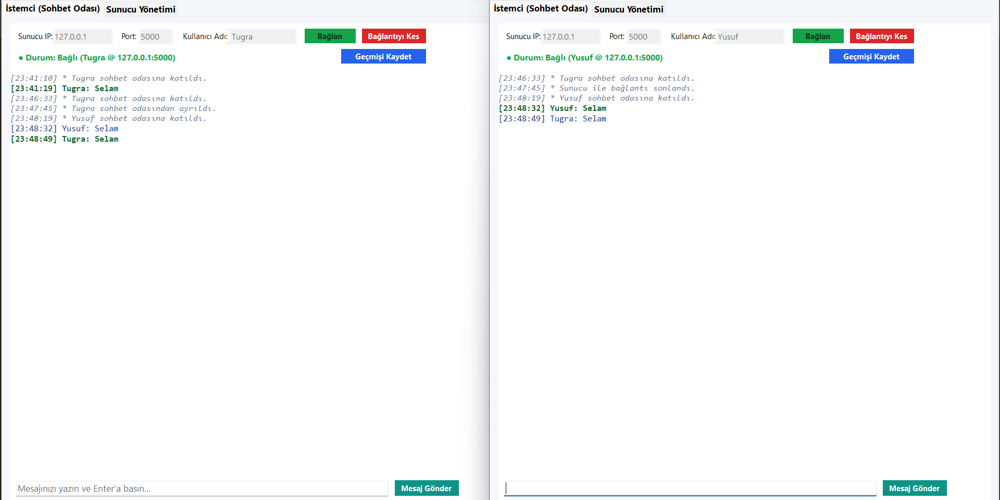
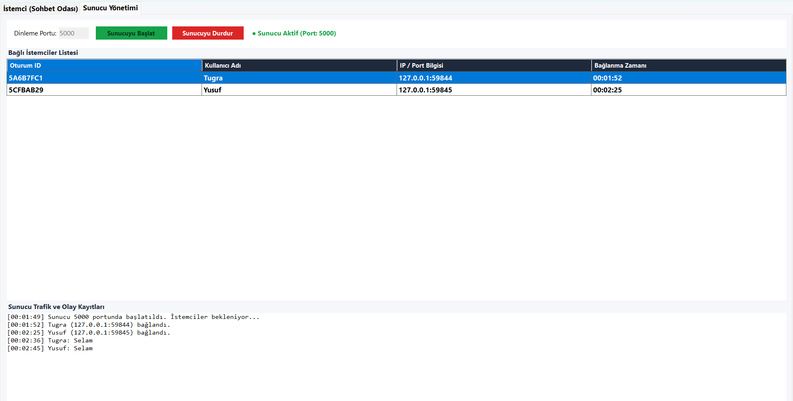

# YMH219-ChatApp

Bu proje, **Fırat Üniversitesi Yazılım Mühendisliği Bölümü** **Nesne Tabanlı Programlama (YMH 219)** dersi kapsamında geliştirilmiş, TCP/IP soket programlama ve asenkron (`async/await`) iletişim mimarisine dayanan C# Windows Forms tabanlı bir **İstemci-Sunucu (Client-Server) Chat Uygulaması**dır.

## Kullanılan Teknolojiler
- **Dil:** C#
- **Platform / Framework:** .NET Windows Forms (WinForms)
- **Ağ Kütüphaneleri:** `System.Net.Sockets` (`TcpListener`, `TcpClient`, `NetworkStream`), `System.IO` (`StreamReader`, `StreamWriter`)
- **Geliştirme Ortamı:** Visual Studio 2026
- **Versiyon Kontrol:** Git & GitHub

## Kurulum ve Çalıştırma Adımları
1. Depoyu bilgisayarınıza klonlayın:
   `git clone https://github.com/yusuftugradeveci23/YMH219-ChatApp.git`
2. İndirilen klasör içerisindeki `YMH219-ChatApp/YMH219-ChatApp.slnx` (veya `.csproj`) dosyasını Visual Studio ile açın.
3. Üst menüden **Derle > Çözümü Derle (Build Solution)** işlemini gerçekleştirin ve **F5** ile uygulamayı başlatın.
4. **Sunucuyu Başlatma:** Açılan pencerede **Sunucu Yönetimi** sekmesine geçin, port numarasını (`5000`) belirleyip **Sunucuyu Başlat** butonuna tıklayın.
5. **İstemci Bağlantısı ve Test:** **İstemci (Sohbet Odası)** sekmesinden kullanıcı adınızı girerek **Bağlan** butonuna tıklayın. Aynı bilgisayarda ikinci bir istemci test etmek için `YMH219-ChatApp.exe` dosyasını bir kez daha çalıştırıp farklı bir kullanıcı adıyla bağlanabilirsiniz.

## Uygulamanın Temel Özellikleri
- **Nesne Tabanlı Sınıf Mimarisi (OOP):** Mesaj paketleme/ayrıştırma `ChatMessage`, istemci oturum modeli `ConnectedClientInfo`, sunucu yönetimi ve yayın (broadcast) mantığı `ChatServer`, istemci bağlantı ve dinleme servisi ise `ChatClientService` sınıflarında modüler olarak tasarlanmıştır.
- **Asenkron Çoklu İstemci Desteği:** `async/await` yapısı sayesinde arayüz donmadan birden fazla istemci aynı sohbet odasına katılabilir ve gerçek zamanlı mesajlaşabilir.
- **Zaman Damgalı Mesajlaşma ve Sistem Bildirimleri:** Gönderilen, alınan ve oda giriş/çıkış bildirimleri saniye hassasiyetinde zaman damgasıyla (`[HH:mm:ss]`) renk kodlu olarak listelenir.
- **Canlı İstemci Takibi (Sunucu Paneli):** Sunucu sekmesinde aktif bağlanan kullanıcıların Oturum ID, Kullanıcı Adı, IP/Port adresi ve bağlanma zamanları tablo halinde canlı güncellenir.
- **Hata Yönetimi ve Sohbet Geçmişi Kaydı:** Sunucu kapalıyken bağlanma veya ani bağlantı kopması durumları uygulamayı çökertmeden kullanıcıya bildirilir; konuşma geçmişi `.txt` dosyası olarak dışa aktarılabilir.

## Ekran Görüntüleri

### İstemci Sohbet Odası ve Karşılıklı Mesajlaşma

### Sunucu Yönetimi ve Bağlı İstemciler Paneli

## Bilinen Sınırlamalar ve Geliştirme Notları
- Mesaj iletiminde satır bazlı özel bir protokol (`MSG|Zaman|Gönderen|İçerik`) ve UTF-8 karakter kodlaması kullanılmıştır.
- İlerleyen sürümlerde kullanıcılar arası özel mesaj (DM) ve oda şifreleme özellikleri eklenebilir.

## Öğrenci Bilgileri
- **Adı Soyadı:** Yusuf Tuğra Deveci
- **Öğrenci Numarası:** 250541095